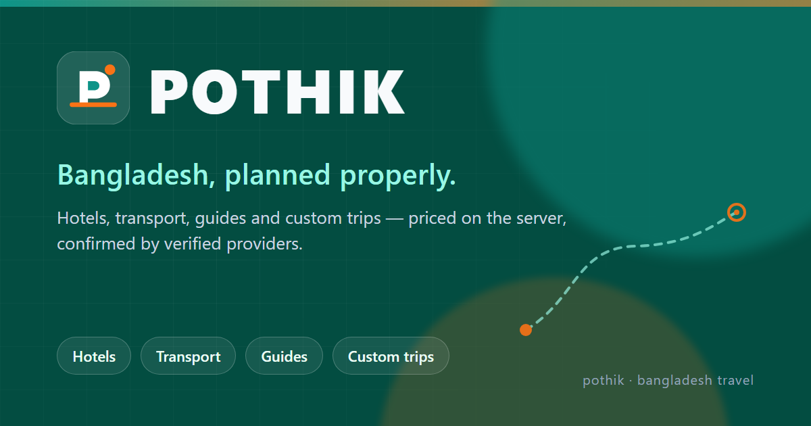

# POTHIK — Online Travel Agency for Bangladesh



POTHIK is a full-stack OTA that lets travellers plan a trip across Bangladesh — hotel rooms, transport, tour guides and curated packages — price it on the server, pay in BDT and manage the booking from one account. Hotels, transport operators and guides get their own dashboard for inventory, reservations and finance. Administrators approve providers, moderate content and move money.

| Area | Stack |
| --- | --- |
| Frontend | React 18, Vite 5, React Router 6, TanStack Query 5, Tailwind CSS 3, Recharts |
| Backend | Node.js 22, Express 4, Sequelize 6, Umzug migrations, Zod validation, Pino logging |
| Data | MySQL 8 (authoritative), Redis + BullMQ (optional jobs/cache) |
| Payments | Gateway abstraction: signed demo gateway (default), SSLCommerz or bKash Tokenized Checkout |
| Auth | JWT access tokens (15 min) + rotating refresh cookie, RBAC, backend ownership checks |
| Tests | Jest + Supertest (backend), Vitest + Testing Library, Playwright (frontend) |

## Roles

Five roles only: `ADMIN`, `HOTEL_OWNER`, `TRANSPORT_PROVIDER`, `TOUR_GUIDE`, `CUSTOMER`.

## Quick start (SQLite, no external services)

```bash
npm run setup                 # install backend + frontend dependencies
cp backend/.env.example backend/.env
cp frontend/.env.example frontend/.env
# set JWT_ACCESS_SECRET / JWT_REFRESH_SECRET in backend/.env (>= 32 chars in production)
cd backend && DB_DIALECT=sqlite SQLITE_STORAGE=tmp/dev.sqlite npm run db:setup && DB_DIALECT=sqlite SQLITE_STORAGE=tmp/dev.sqlite npm start
cd frontend && npm run dev
```

Open http://localhost:5173. Demo users created by seeders use the password from `SEED_DEMO_PASSWORD` (development default `PothikDemo123`; production seeding refuses to run without an explicit value):

| Role | Email |
| --- | --- |
| CUSTOMER | customer@pothik.test |
| HOTEL_OWNER | hotel.owner@pothik.test |
| TRANSPORT_PROVIDER | transport@pothik.test |
| TOUR_GUIDE | guide@pothik.test |

The admin account is created from `ADMIN_EMAIL` / `ADMIN_PASSWORD` in `backend/.env`; no admin password is baked into code or seeders.

Demo content covers all nine destinations, each with at least one published hotel, rooms and 120 days of availability, so every trip-builder step has inventory. Seeders are recorded per file: if your database was seeded before a seeder changed, re-run it by deleting that file's row from `sequelize_seed_meta` (or rebuild the demo database) before `npm run db:seed`.

## Run with the published Docker images

The full stack (MySQL, Redis, migrations, two API replicas, BullMQ worker, Nginx, SPA) is published to Docker Hub and can be run without the source build toolchain:

| Image | Visibility |
| --- | --- |
| `ibrahim12zihad/pothik-api:1.0.2` (`latest` = 1.0.2) | Private — requires Docker Hub access |
| `ibrahim12zihad/pothik-web:1.0.2` (`latest` = 1.0.2) | Public |

`pothik-api` is private, so you need permission from the repository owner (`ibrahim12zihad` on Docker Hub) before you can pull it. Without access, build from source instead with the tracked compose file: `docker compose -f docker-compose.yml up -d --build`.

Prerequisites: Docker Engine 24+ with the Compose v2 plugin, ~2 GB free RAM and port 80 free. The images are `linux/amd64`; on ARM hosts set `DOCKER_DEFAULT_PLATFORM=linux/amd64` (emulated, slower).

```bash
git clone <repository-url> pothik && cd pothik/deployment
cp .env.example .env

# Edit .env before starting. Minimum for a local evaluation:
#   NODE_ENV=development
#   PUBLIC_URL=http://localhost
#   HTTP_PORT=80
#   MYSQL_ROOT_PASSWORD=<random>
#   MYSQL_PASSWORD=<random>
#   JWT_ACCESS_SECRET=<openssl rand -hex 32>
#   JWT_REFRESH_SECRET=<a different openssl rand -hex 32>
#   PAYMENT_CALLBACK_SECRET=<random>
#   PAYMENT_GATEWAY=demo
#   SEED_DEMO_PASSWORD=<password for the demo accounts>
#   ADMIN_EMAIL=admin@example.com
#   ADMIN_PASSWORD=<password for the first administrator>

docker login                      # only needed for the private pothik-api image
docker compose --env-file .env -f docker-compose.yml -f docker-compose.hub.yml pull
docker compose --env-file .env -f docker-compose.yml -f docker-compose.hub.yml up -d --no-build

# Optional demo data (destinations, packages, hotels/rooms with availability,
# providers, sample bookings and reviews). Run once, on a fresh database.
docker compose --env-file .env -f docker-compose.yml -f docker-compose.hub.yml --profile seed run --rm seed
```

Open `http://localhost`. The `migrate` service runs `node src/database/cli.js migrate` on every start before the API containers boot, so the schema is created automatically. Verify with:

```bash
docker compose --env-file .env -f docker-compose.yml -f docker-compose.hub.yml ps
curl -fsS http://localhost/api/v1/health
```

Sign in with the administrator from `ADMIN_EMAIL`/`ADMIN_PASSWORD` (created by the seeder), or the demo travellers from the table above using `SEED_DEMO_PASSWORD`.

Notes before using it outside a demo machine:

- `PUBLIC_URL` must be the exact public origin. The published `pothik-web` image was built with `http://localhost` baked into canonical/OG URLs and API base paths; for another origin rebuild it from source with `PUBLIC_URL=https://your-domain.example` (`docker compose --env-file .env -f docker-compose.yml build frontend`).
- Keep `NODE_ENV=development` for plain-HTTP evaluation. With `NODE_ENV=production` the refresh cookie is `Secure` (sign-in needs HTTPS) and the `demo` gateway is refused at boot; use `sslcommerz` or `bkash` credentials, or put a TLS proxy in front.
- To change release, edit the tags in `deployment/docker-compose.hub.yml`, then re-run `pull` and `up -d --no-build`.
- Data lives in the named volumes `mysql_data`, `redis_data` and `uploads`. `down` keeps them; `down -v` deletes all database, job and upload state.

## Documentation

| Document | Contents |
| --- | --- |
| [docs/PROJECT_AUDIT.md](docs/PROJECT_AUDIT.md) | What is implemented, what was verified, what is still pending |
| [docs/ARCHITECTURE.md](docs/ARCHITECTURE.md) | Layering, modules, request lifecycle, nine Mermaid diagrams |
| [docs/DATABASE_DESIGN.md](docs/DATABASE_DESIGN.md) | ER diagram and table reference |
| [docs/API_DOCUMENTATION.md](docs/API_DOCUMENTATION.md) | Endpoint catalogue, envelope, error codes, examples |
| [docs/AUTHENTICATION.md](docs/AUTHENTICATION.md) | Token rotation, RBAC, ownership enforcement |
| [docs/BOOKING_WORKFLOW.md](docs/BOOKING_WORKFLOW.md) | State machine, quoting, anti-overbooking |
| [docs/PAYMENT_WORKFLOW.md](docs/PAYMENT_WORKFLOW.md) | Gateways, idempotency, refunds, commissions, payouts |
| [docs/LOAD_BALANCING.md](docs/LOAD_BALANCING.md) | Stateless scaling, Nginx upstream, queues, caching |
| [docs/DEPLOYMENT.md](docs/DEPLOYMENT.md) | Docker Compose topology, environment, operations |
| [docs/TESTING.md](docs/TESTING.md) | How to run every suite and what it covers |
| [docs/IMPLEMENTATION_PROGRESS.md](docs/IMPLEMENTATION_PROGRESS.md) | Phased progress log with evidence |

Interactive API reference: `/api-docs` (Swagger UI) and `/openapi.json`. The OpenAPI 3.0.3 document is generated from the source (`cd backend && npm run openapi`) and covers 115 paths / 142 operations; a copy is written to [docs/openapi.json](docs/openapi.json), with the narrative catalogue in [docs/API_DOCUMENTATION.md](docs/API_DOCUMENTATION.md).

## Link previews and SEO

- `frontend/index.html` ships canonical, Open Graph and Twitter-card defaults plus an Organization/WebSite JSON-LD graph. Absolute URLs are injected at build time from `VITE_SITE_URL` (Docker: `PUBLIC_URL`), so crawlers that never execute JavaScript still get a branded preview.
- Public pages override title, description, image and JSON-LD per route in [frontend/src/lib/seo.js](frontend/src/lib/seo.js): `TouristDestination`, `TouristTrip`, `Hotel`, `Product` (vehicles), `Service` (guides), `BlogPosting`, `CollectionPage` and `BreadcrumbList`. Search and dashboard routes are `noindex`.
- [frontend/public/og.png](frontend/public/og.png) is a 1200×630 PNG generated by `npm run og:image`; SVG cover images fall back to it because social scrapers reject SVG.
- Build with your public origin: `VITE_SITE_URL=https://your-domain.example npm run build`. The Docker build takes the same value from `PUBLIC_URL`.
- Limitation: this is a client-rendered SPA. WhatsApp, Facebook and LinkedIn read only the static `<head>`, so shared detail links show the branded site preview; Google/Bing see the page-specific metadata because they execute JavaScript. Page-specific previews for non-JS crawlers need SSR or prerendering, which is not implemented.

## Layout

```
backend/   Express API: modules (auth, catalog, bookings, payments, reviews, suppliers,
           trips, notifications, admin, dashboards), models, migrations, seeders, tests
frontend/  React SPA: public site, auth, customer/provider/admin dashboards
deployment/ Docker Compose, Nginx, scripts
docs/      Architecture and operations documentation
```

## Honesty note

The application was developed and verified end-to-end against SQLite with the demo payment gateway. MySQL 8, Redis/BullMQ, Docker/Nginx, SSLCommerz and bKash are implemented but were **not** executed in this environment (bKash is covered by mocked-API unit tests and an integration settlement test); see PROJECT_AUDIT.md for the exact verification matrix before claiming production readiness.
