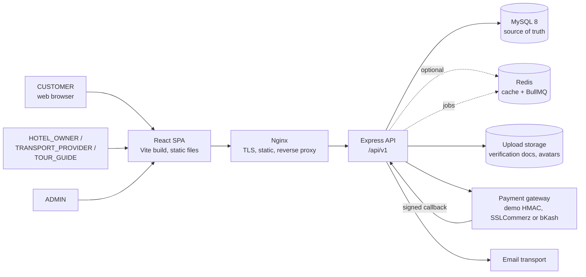
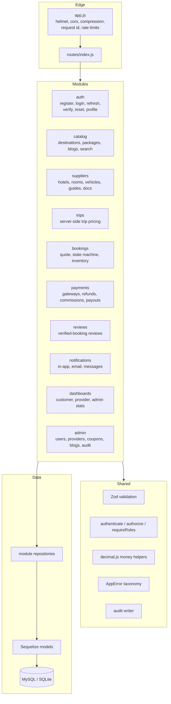
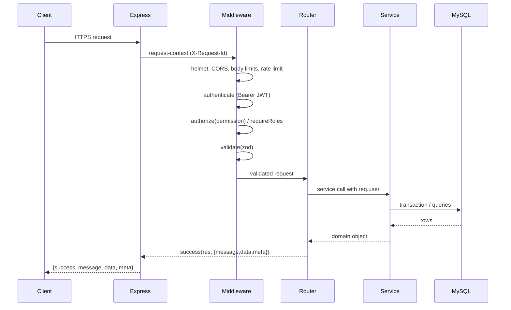

# Architecture

POTHIK is a **modular monolith**: one deployable API process with hard module boundaries, plus a static React SPA. That keeps transactional booking and payment logic in one database while still allowing the API tier to scale horizontally behind a load balancer.

## 1. System context



Redis is **never** the source of truth for bookings, payments, inventory or balances. If Redis is absent, the API runs background jobs inline and caches in process memory.

## 2. Backend module map



Every module follows the same layers:

```
*.routes.js     HTTP wiring, permissions, validation
*.validators.js Zod schemas for body/query/params
*.service.js    business rules, transactions, serializers
*.repository.js queries and eager-loading
```

Routes never hold business rules; services never read `req`; repositories never decide authorization.

## 3. Request lifecycle



Errors take the same path. `errorHandler` converts `AppError`, Zod, Sequelize constraint errors and Multer errors into the standard failure envelope with a stable `code`; unexpected errors return `INTERNAL_ERROR` plus the request id.

## 4. Response envelope

Every API response is one of:

```json
{ "success": true,  "message": "…", "data": { }, "meta": { "page": 1, "limit": 20, "total": 57 } }
{ "success": false, "message": "…", "code": "MACHINE_CODE", "errors": [{ "field": "email", "message": "…" }] }
```

`meta` is present on paginated collections. HTTP status codes stay meaningful (200/201/204, 400, 401, 403, 404, 409, 413, 422, 429, 503).

## 5. Cross-cutting concerns

| Concern | Implementation |
| --- | --- |
| Money | `decimal.js`; BDT amounts stored as `DECIMAL(12,2)` and serialized as strings |
| IDs | Auto-increment BIGINT internally; bookings have public references (`PTK-…`) |
| Time | UTC in the database; dates rendered in the user's locale |
| Logging | Pino structured logs with request id; no tokens or passwords logged |
| Rate limits | Global API limiter, stricter auth limiter, write limiter on money/booking endpoints |
| Uploads | Multer, MIME allow-list (JPEG/PNG/WEBP/PDF), 5 MB default, served from `/uploads` |
| Ownership | Services resolve the caller's provider profile; a provider can only touch their own inventory, bookings and finance |
| Audit | Admin decisions and financial transitions write `audit_logs` with actor, IP and request id |
| i18n | SPA dictionaries for English and Bangla; backend stores canonical English enum values |

## 6. Related diagrams

- ER model: [DATABASE_DESIGN.md](DATABASE_DESIGN.md)
- Booking state machine and transaction flow: [BOOKING_WORKFLOW.md](BOOKING_WORKFLOW.md)
- Access/refresh rotation: [AUTHENTICATION.md](AUTHENTICATION.md)
- Payment sequence: [PAYMENT_WORKFLOW.md](PAYMENT_WORKFLOW.md)
- Deployment topology and queue degradation: [LOAD_BALANCING.md](LOAD_BALANCING.md)
