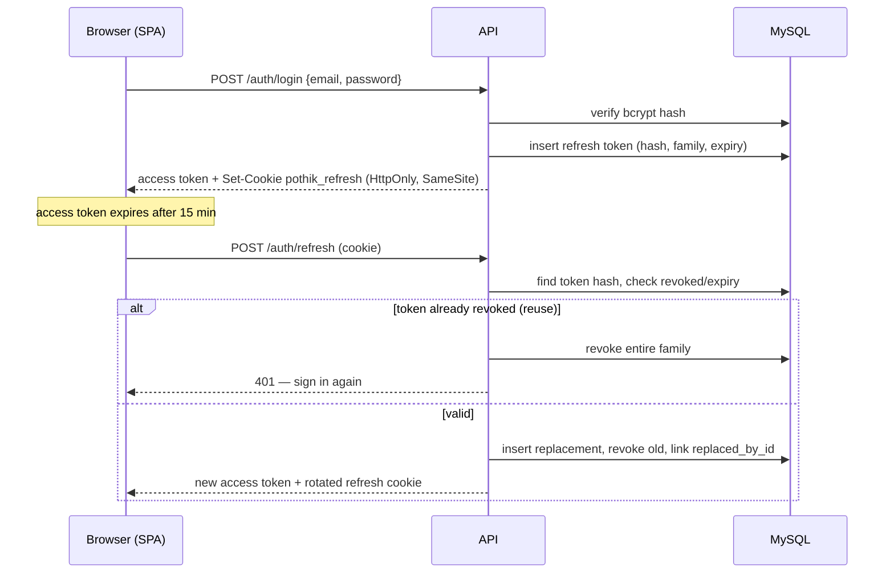

# Authentication and Authorization

## Accounts

One `users` table holds every role. On registration the account is created with a single role (`CUSTOMER` by default); providers register with `HOTEL_OWNER`, `TRANSPORT_PROVIDER` or `TOUR_GUIDE` and then submit a provider profile plus verification documents. The role is never accepted from the client for admin operations.

Passwords are hashed with bcrypt (`BCRYPT_ROUNDS`, default 12). Password hashes, refresh tokens and verification tokens are never serialized by the API.

## Access tokens

- JWT, HS256, lifetime `ACCESS_TOKEN_TTL` (15 minutes).
- Claims: `sub`, `type: "access"`, `jti`.
- Sent as `Authorization: Bearer <token>`. The SPA keeps it in memory only — never in `localStorage`.
- Every protected request reloads the user's role, status and provider profile from the database (`loadUserContext`), so suspending a user or revoking roles takes effect immediately instead of waiting for token expiry.

## Refresh tokens and rotation

Refresh sessions are stored as SHA-256 hashes in `refresh_tokens` with a `family_id`.



Rules enforced by `auth.service.refresh`:

1. A missing or invalid refresh token returns 401.
2. Reusing a revoked token revokes the whole token family (theft containment).
3. Suspended or deleted users cannot refresh.
4. Logout revokes the presented token. Changing a password revokes the user's other sessions.
5. The cookie is `httpOnly`, `sameSite=lax`, `secure` in production, and scoped to `/api/v1/auth`.

## Email verification and password reset

- Verification and reset links carry single-use random tokens; only their SHA-256 hash is stored (`verification_tokens`), with `purpose` and `expires_at`.
- `forgot-password` always returns 200 so the endpoint cannot be used to enumerate accounts.
- Verification marks `email_verified_at` and activates the account.

## Authorization

Two layers, both on the server:

### 1. Permission gates

Routes declare a permission, for example `authorize(PERMISSIONS.PAYOUTS_APPROVE)`; admin routers additionally use `requireRoles(ROLES.ADMIN)`. Permissions are defined in `shared/constants/roles.js` and seeded into `roles` / `permissions` / `role_permissions`.

| Role | Representative permissions |
| --- | --- |
| CUSTOMER | book, pay, request refunds, review completed bookings, own trips/notifications |
| HOTEL_OWNER | own hotels/rooms + availability, provider bookings, own finance, request payouts |
| TRANSPORT_PROVIDER | own vehicles/drivers + availability, provider bookings, own finance, payouts |
| TOUR_GUIDE | own guide profile + availability, provider bookings, own finance, payouts |
| ADMIN | every permission, including approvals, moderation, all finance and audit |

### 2. Ownership checks

Permissions answer *what kind of action* is allowed; services answer *which records*. Examples:

- `suppliers.service` resolves the caller's `provider_profiles` row and scopes every hotel/room/vehicle/guide query to it.
- `booking.repository` for providers filters on `provider_profile_id`; a provider requesting another provider's reference receives 404, not data.
- `payment.service.requestPayout` computes the balance from the caller's own commissions and rejects amounts above it with `PAYOUT_EXCEEDS_BALANCE`.
- Refunds can only be requested by the booking's customer; admin decisions require `refunds:approve`.
- Notifications and messages are scoped by `user_id`.

A customer hitting a provider route receives 403 (`PROVIDER_ONLY`); the SPA also hides links, but the API decision is authoritative.

## Provider onboarding states

```
register (PENDING_VERIFICATION)
  → verify email (ACTIVE)
  → submit provider profile + documents (profile PENDING)
  → admin verifies documents
  → admin approves (profile APPROVED, optional commission override)
  → inventory becomes publicly bookable
```

Suspended providers keep their records but cannot publish inventory, accept new bookings or request payouts.

## Operational guidance

- Rotate `JWT_ACCESS_SECRET` / `JWT_REFRESH_SECRET` together; rotating secrets invalidates outstanding sessions.
- Keep `COOKIE_SECURE=true` and TLS termination in front of the API in production.
- `CORS_ORIGINS` must list the exact SPA origins; credentials are enabled.
- Audit entries record admin and financial actions with actor, IP and request id.
