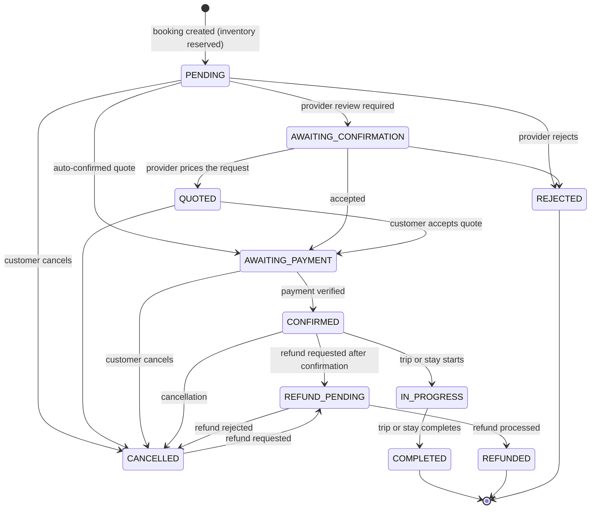
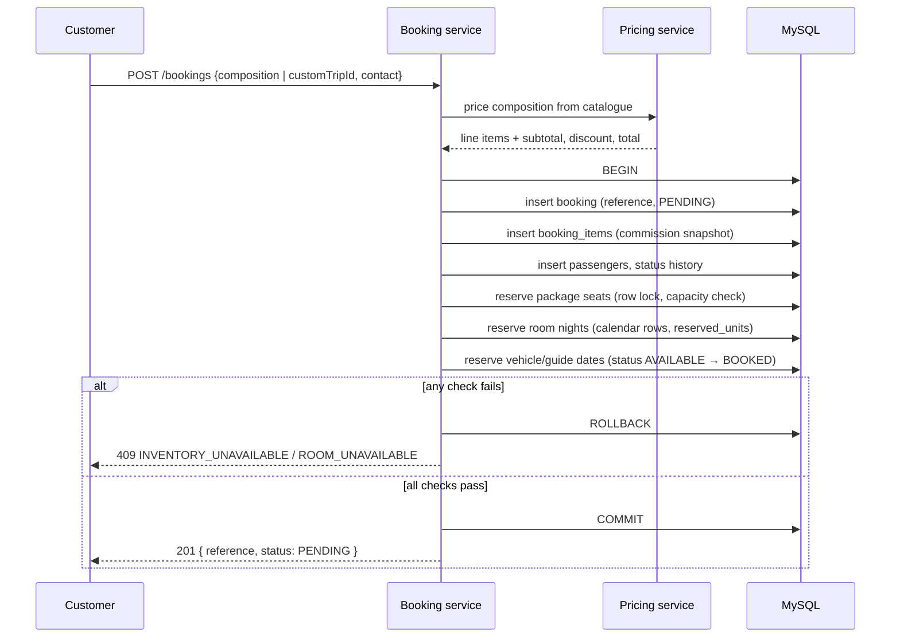

# Booking Workflow

## 1. State machine

Every booking status change goes through `booking.state.transitionBooking()`; no code path writes `bookings.status` freely.

Notes:

- `COMPLETED`, `REJECTED` and `REFUNDED` are terminal.
- Cancellation from any active state releases reserved inventory (rooms, vehicle/guide dates, package seats).
- A payment can only confirm a booking in `AWAITING_PAYMENT`; overpayment is rejected.

## 2. Creation and anti-overbooking

The client sends a composition (hotel/vehicle/guide/package) or a saved custom trip. The server never trusts client prices.

Concurrency guarantees:

1. **Single transaction** — header, items, passengers, history and inventory reservations commit or roll back together.
2. **Row locks** — availability and departure rows are read with `SELECT … FOR UPDATE` inside the transaction before they are mutated (MySQL). Two simultaneous requests for the last unit serialize; the second sees the updated count and fails cleanly.
3. **Per-date calendar rows** — hotel rooms reserve each night in `room_availability` (`reserved_units`), so partial stays and two-room bookings cannot oversell a date. Vehicle and guide dates are binary (`BOOKED`).
4. **Capacity check for departures** — `booked_count + seats > capacity` is rejected with `DEPARTURE_FULL`.
5. **Release on cancel/reject** — `releaseInventory` runs in the same transaction as the status change, restoring counts and clearing `booking_item_id`.
6. **Commission snapshot** — `commission_rate`, `commission_amount` and `provider_payable` are written on each item at creation, so later commission changes never rewrite history.

## 3. Provider lifecycle actions

| Action | Endpoint | Effect |
| --- | --- | --- |
| Accept | `POST /provider/bookings/:reference/accept` | Moves the reservation toward payment/confirmation; items become `CONFIRMED` |
| Reject | `POST /provider/bookings/:reference/reject` | `REJECTED`, inventory released, customer notified |
| Start | `POST /provider/bookings/:reference/start` | `CONFIRMED → IN_PROGRESS` |
| Complete | `POST /provider/bookings/:reference/complete` | `IN_PROGRESS → COMPLETED`; commission rows become `EARNED` and the provider's payable is cleared for payout; loyalty points awarded |

Provider calls are scoped: the service confirms the caller's provider profile owns at least one item on the booking. Other providers receive 404.

## 4. Cancellation, refunds and inventory

- Customer cancellation (`POST /bookings/:reference/cancel`) is allowed only from active states and requires a reason; it releases inventory and records `cancelled_at` and the reason.
- After cancellation, the customer may request a refund (`POST /payments/refunds`). The booking moves to `REFUND_PENDING`; the customer is refunded only after an admin approves and processes the refund (see [PAYMENT_WORKFLOW.md](PAYMENT_WORKFLOW.md)).
- Rejecting the last open refund returns the booking to `CANCELLED`.

## 5. Pricing rules

- All prices, commissions, discounts and totals are computed server-side by `pricing.service` using `decimal.js`.
- Coupons are validated for active window, minimum spend, usage limit, per-user limit and stacking rules; `coupon_redemptions` records each use.
- Child pricing and package departures use catalogue values; custom add-ons come from the add-on catalogue.
- The quote returned by `POST /trips/quote` is informational; creation re-prices immediately before persisting.

## 6. Notifications

Booking transitions enqueue notifications (in-app + email) for the customer and the affected providers: payment received, booking confirmed, reservation received, provider decisions, refund updates and payout updates. When Redis is unavailable jobs run inline (see [LOAD_BALANCING.md](LOAD_BALANCING.md)).

## 7. Known limitation

`bookings.expires_at` exists in the schema, but **automatic expiry of abandoned unpaid bookings is not implemented**. Unpaid bookings keep their inventory reservation until they are cancelled or rejected. This is recorded in [PROJECT_AUDIT.md](PROJECT_AUDIT.md); it must be added (scheduled job + release) before operating at scale.
