# Database Design

MySQL 8 is the authoritative store (SQLite is supported for local development and the test harness). Schema changes are versioned with Umzug migrations; the application never calls `sequelize.sync({ alter: true })`.

## Entity relationship diagram

```mermaid
erDiagram
  users ||--o{ user_roles : has
  roles ||--o{ user_roles : grants
  roles ||--o{ role_permissions : holds
  permissions ||--o{ role_permissions : in
  users ||--o{ refresh_tokens : owns
  users ||--o{ verification_tokens : owns
  users ||--o{ loyalty_transactions : earns
  users ||--o| provider_profiles : operates
  provider_profiles ||--o{ provider_documents : submits
  provider_profiles ||--o{ hotels : owns
  provider_profiles ||--o{ vehicles : owns
  provider_profiles ||--o{ drivers : employs
  provider_profiles ||--o| guides : has
  provider_profiles ||--o{ commissions : earns
  provider_profiles ||--o{ provider_payouts : requests

  divisions ||--o{ districts : contains
  districts ||--o{ upazilas : contains
  destinations ||--o{ tourist_spots : includes
  destination_categories ||--o{ destinations : classifies

  hotels ||--o{ hotel_rooms : has
  hotel_rooms ||--o{ room_availability : calendar
  vehicles ||--o{ vehicle_availability : calendar
  guides ||--o{ guide_availability : calendar
  vehicles }o--|| vehicle_categories : typed

  packages ||--o{ package_departures : schedules
  packages ||--o{ package_itineraries : details
  packages ||--o{ package_destinations : covers
  destinations ||--o{ package_destinations : in

  custom_trips ||--o{ custom_trip_items : composes
  custom_trips ||--o| bookings : converts_to

  bookings ||--o{ booking_items : contains
  bookings ||--o{ booking_passengers : carries
  bookings ||--o{ booking_status_history : logs
  bookings ||--o{ payments : paid_by
  bookings ||--o{ refunds : refunded_by
  bookings ||--o{ reviews : reviewed_by
  bookings }o--o| coupons : applies
  booking_items ||--o| commissions : generates
  bookings ||--o{ loyalty_transactions : earns

  users ||--o{ notifications : receives
  users ||--o{ messages : exchanges
  blogs }o--|| users : authored_by
  audit_logs }o--|| users : actor
```



## Core tables

### Identity and access

| Table | Purpose | Key columns |
| --- | --- | --- |
| `users` | All five roles share one account table | `email` (unique), `password_hash` (bcrypt), `status` (`PENDING_VERIFICATION`, `ACTIVE`, `SUSPENDED`), `locale` |
| `roles` / `permissions` | RBAC catalogue | `roles.code` (`ADMIN`, `HOTEL_OWNER`, `TRANSPORT_PROVIDER`, `TOUR_GUIDE`, `CUSTOMER`) |
| `user_roles` | One role per user in practice; table supports future multi-role grants | `user_id`, `role_id` |
| `role_permissions` | Permission grants per role | `role_id`, `permission_id` |
| `refresh_tokens` | Rotating refresh sessions | `token_hash`, `expires_at`, `revoked_at`, `replaced_by_token_id`, `user_agent`, `ip` |
| `verification_tokens` | Email verification and password reset | `token_hash`, `purpose`, `consumed_at`, `expires_at` |
| `audit_logs` | Who did what, from where | `actor_user_id`, `action`, `entity_type`, `entity_id`, `metadata`, `ip`, `request_id` |

### Catalog and supply

| Table | Purpose | Notes |
| --- | --- | --- |
| `divisions` → `districts` → `upazilas` | Bangladesh geography | Seeded with 8 divisions, 64 districts |
| `destinations`, `destination_categories`, `tourist_spots` | Marketing catalogue | Slug-based public URLs |
| `packages`, `package_departures`, `package_itineraries`, `package_destinations` | Curated trips | Departures carry capacity and `booked_count` |
| `hotels`, `hotel_rooms` | Hotel inventory | Rooms carry `base_price`, `total_units` |
| `room_availability`, `vehicle_availability`, `guide_availability` | Per-date calendar | `reserved_units` / `status` updated inside booking transactions |
| `vehicles`, `vehicle_categories`, `drivers` | Transport inventory | `price_per_day`, capacity, driver assignment |
| `guides` | Guide inventory | `daily_rate`, languages, experience |
| `provider_profiles`, `provider_documents` | Supplier onboarding and KYC | `status` (`PENDING`, `APPROVED`, `SUSPENDED`), per-provider `commission_rate` override |

### Commerce

| Table | Purpose | Notes |
| --- | --- | --- |
| `bookings` | Booking header | Public `reference`, status, dates, contact snapshot, money columns, `expires_at` |
| `booking_items` | One line per priced service | `item_type` (`PACKAGE`, `HOTEL_ROOM`, `VEHICLE`, `GUIDE`, `SERVICE`), provider, commission snapshot, `provider_payable` |
| `booking_passengers` | Traveller names | Kept separate so an item can carry multiple travellers |
| `booking_status_history` | State machine journal | `from_status`, `to_status`, `reason`, actor |
| `coupons`, `coupon_redemptions` | Discount codes | `type` (`PERCENT`/`FIXED`), limits, `used_count` |
| `payments` | Gateway attempts | `idempotency_key` (unique), `provider`, `provider_txn_id`, `status`, `verified_at` |
| `refunds` | Refund lifecycle | `REQUESTED → APPROVED → PROCESSED` or `REJECTED`; `provider_refund_id` |
| `commissions` | Platform earnings per item | One row per `booking_item_id`; `gross_amount`, `rate`, `amount`, `status` |
| `provider_payouts` | Provider withdrawals | `REQUESTED → APPROVED → PAID` or `REJECTED`; `reference` stores bank/bKash transaction id |
| `loyalty_transactions` | Points ledger | Earned on completed bookings |

### Content and communication

| Table | Purpose |
| --- | --- |
| `reviews` | Booking-verified reviews for packages/destinations/hotels/guides; moderation status, provider reply |
| `blogs` | Journal posts with draft/published/archived lifecycle |
| `notifications` | In-app notifications with read state |
| `messages` | Customer ↔ provider/admin threads per booking |
| `platform_settings` | Operational settings stored as JSON |

## Money and time conventions

- Monetary columns are `DECIMAL(12,2)`; the API serializes them as strings (`"9680.00"`) to avoid float drift.
- Commission and payable amounts are **snapshotted on the booking item** at confirmation time, so later rate changes never rewrite historical money.
- Dates use `DATEONLY` for travel dates and UTC timestamps for audit fields.

## Indexing

- Unique indexes: `users.email`, `bookings.reference`, `payments.idempotency_key`, `coupons.code`, catalogue slugs.
- Foreign-key indexes on every `*_id` used for joins.
- Working indexes on `bookings.customer_user_id`, `bookings.status`, `bookings.type`, `bookings.start_date`, and calendar tables on `(resource_id, date)`.

## Migrations and seeders

```
backend/src/database/migrations/   schema history (001…)
backend/src/database/seeders/      demo data (001 roles … 007 bookings)
backend/src/database/cli.js        migrate | rollback | seed | setup
npm run db:migrate                 apply pending migrations
npm run db:seed                    apply pending seeders
npm run db:setup                   migrate + seed
```

Seeders are idempotent: they use `findOrCreate` and reconcile dependent rows (for example a cancelled booking is kept in step with the status of its refund). They never contain production credentials; demo passwords come from `SEED_DEMO_PASSWORD`.
