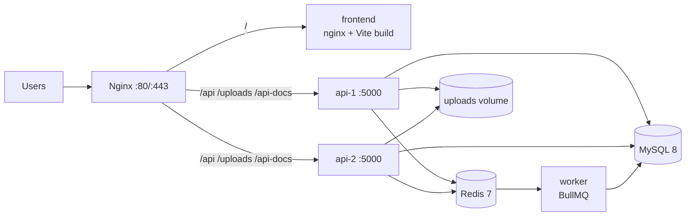

# Deployment

POTHIK ships a Docker Compose topology: MySQL 8, Redis, two stateless API replicas, a dedicated BullMQ worker, the built React SPA and an edge Nginx.

> **Verification status:** the compose file, Dockerfiles and Nginx config are provided but were **not executed** in this environment (no Docker CLI). Treat them as a reviewed starting point, not a tested deployment. Validate them in staging before production. See [PROJECT_AUDIT.md](PROJECT_AUDIT.md).

## Topology



| Service | Purpose | Notes |
| --- | --- | --- |
| `mysql` | Source of truth | utf8mb4, UTC, healthcheck, named volume |
| `redis` | BullMQ queue + cache | AOF enabled, `noeviction` policy |
| `migrate` | One-shot Umzug migrations | Must complete before APIs start |
| `seed` | Optional demo data | Profile `seed`, run explicitly |
| `api-1`, `api-2` | Stateless Express replicas | Same image, shared uploads volume |
| `worker` | Dedicated BullMQ worker | Same image, `src/infrastructure/jobs/worker.js` |
| `frontend` | Static SPA server | Nginx image with history fallback |
| `nginx` | Edge proxy | Least-connections upstream, TLS termination point |

## 1. Prerequisites

- Docker Engine 24+ with Compose v2.17+ (needed for `service_completed_successfully`).
- A domain name and TLS certificates for production.
- Payment gateway credentials for the gateway you enable — SSLCommerz (`SSLCOMMERZ_*`) or bKash Tokenized Checkout (`BKASH_*`).
- An SMTP/API email provider — **the shipped mailer only logs** (see limitations).

## 2. Configure

```bash
cd deployment
cp .env.example .env
```

Fill in every value. Generate secrets with:

```bash
openssl rand -hex 32   # run separately for JWT_ACCESS_SECRET, JWT_REFRESH_SECRET, PAYMENT_CALLBACK_SECRET
```

Important rules:

- `NODE_ENV=production` plus `PAYMENT_GATEWAY=demo` is rejected at boot by `backend/src/config/index.js`.
- `ADMIN_PASSWORD` is used only by the admin seeder. Set it deliberately, then keep it out of version control.
- `PUBLIC_URL` must be the exact HTTPS origin users hit; it drives CORS, gateway return URLs and the canonical/Open Graph URLs baked into the frontend build.
- Never commit `deployment/.env`.

## 3. Build and start

```bash
cd deployment
docker compose build
docker compose up -d mysql redis migrate
docker compose up -d api-1 api-2 worker frontend nginx
```

`migrate` runs `node src/database/cli.js migrate` once and exits; the API and worker wait for it to complete. Verify:

```bash
docker compose ps
curl -fsS http://localhost/api/v1/health/ready
curl -fsS http://localhost/nginx-health
```

### Link previews

The frontend image receives `PUBLIC_URL` as the `VITE_SITE_URL` build argument, so canonical, `og:url` and `og:image` are absolute in the built `index.html`. After changing the domain, rebuild the frontend:

```bash
docker compose build --no-cache frontend
docker compose up -d --no-deps frontend
```

Check the delivered head with `curl -fsS http://localhost/ | grep -E 'og:image|canonical'`. WhatsApp/Facebook/LinkedIn read only this static head, so they show the site-level preview for every URL; Google/Bing execute JavaScript and see per-page metadata. Page-specific previews for non-JS crawlers need SSR or prerendering (not implemented).

### Demo data (staging only)

```bash
./scripts/seed.sh
```

This requires `SEED_DEMO_PASSWORD` and `ADMIN_PASSWORD`. Demo users then log in with `customer@pothik.test`, `hotel.owner@pothik.test`, `transport@pothik.test`, `guide@pothik.test` and the password you set. Do not seed demo content in production.

Demo content includes a published hotel (rooms plus 120 days of availability) for each of the nine destinations. Seeder execution is tracked per file in `sequelize_seed_meta`, so a staging database seeded before a seeder changed needs that file's row removed — or a rebuild — before re-running `seed` picks up the new data.

## 4. TLS

1. Obtain certificates (certbot or your load balancer).
2. Mount them into the `nginx` service and uncomment the 443 mapping in `docker-compose.yml`.
3. Uncomment and complete the TLS server block in `deployment/nginx/pothik.conf` (duplicate the location blocks), enable HSTS, and redirect HTTP to HTTPS.
4. Set `PUBLIC_URL=https://your-domain` and restart the APIs so CORS and callbacks use the HTTPS origin.

If TLS terminates at a cloud load balancer instead, keep Nginx on HTTP inside the private network and forward `X-Forwarded-Proto`. The API sets `trust proxy` and reads client IPs from forwarded headers.

## 5. Environment reference

All keys are documented in `deployment/.env.example` and `backend/.env.example`. The most consequential:

| Variable | Effect |
| --- | --- |
| `JWT_ACCESS_SECRET`, `JWT_REFRESH_SECRET` | Token signing; minimum 32 characters in production |
| `PAYMENT_GATEWAY` | `sslcommerz` or `bkash` in production; `demo` only outside production |
| `PAYMENT_CALLBACK_SECRET` | Verifies demo/HMAC callbacks |
| `SSLCOMMERZ_*` | SSLCommerz merchant credentials and sandbox flag |
| `BKASH_APP_KEY`, `BKASH_APP_SECRET`, `BKASH_USERNAME`, `BKASH_PASSWORD` | bKash Tokenized Checkout credentials; `BKASH_SANDBOX` and `BKASH_BASE_URL` are optional |
| `DB_POOL_MAX` | Per-replica pool; keep `pool × replicas < MySQL max_connections` |
| `RATE_LIMIT_MAX`, `AUTH_RATE_LIMIT_MAX` | Per-process limits (see scaling caveat) |
| `SEED_DEMO_PASSWORD`, `ADMIN_*` | Seed data and bootstrap administrator |
| `MAX_UPLOAD_MB` | Must be below Nginx `client_max_body_size` (10 MB) |

## 6. Scaling

The API keeps no request state: JWTs are bearer tokens, refresh tokens live in MySQL, uploads live on a shared volume, and Redis holds only cache and jobs.

- Add `api-3`, `api-4` services using the same YAML anchor and add them to the `pothik_api` upstream, then `docker compose exec nginx nginx -s reload`.
- Keep one MySQL primary for bookings and payments; scale reads only when there is a measured need.
- Run one or more workers. Every worker consumes the same queue, so jobs are processed once.
- Rate limiting is per process today; move it to the edge (`limit_req`) or Redis if you need a strict global limit.
- Uploads must be on a shared volume (or object storage) for every replica; the compose file mounts the `uploads` volume into both APIs.

## 7. Uploads and private documents

- Public images and PDFs: `uploads/` volume, served at `/uploads/...`.
- Provider verification documents: `uploads/private/`, **never** served by the static handler. They are streamed by `GET /api/v1/provider/documents/:id/file` (owner) and `/api/v1/admin/providers/:id/documents/:documentId/file` (admin).
- Back up the `uploads` volume together with MySQL; losing it breaks document links.

## 8. Backups and restore

```bash
cd deployment
./scripts/backup.sh                                  # gzip dump into deployment/backups
BACKUP_RETENTION_DAYS=30 ./scripts/backup.sh         # override retention
```

Restore into the running MySQL service:

```bash
gunzip -c deployment/backups/pothik-YYYYmmdd-HHMMSS.sql.gz \
  | docker compose -f deployment/docker-compose.yml exec -T mysql sh -c \
    'exec mysql -uroot -p"$MYSQL_ROOT_PASSWORD" "$MYSQL_DATABASE"'
```

Back up the uploads volume with your infrastructure tooling (`docker run --rm -v pothik_uploads:/data ... tar`). Verify restores periodically in a scratch environment.

## 9. Upgrades and rollback

1. Back up MySQL and uploads.
2. Pull/build the new images.
3. Run `./scripts/migrate.sh` (migrations are additive and reviewed; never use `sequelize.sync({ alter: true })`).
4. Recreate `api-1`, `api-2`, `worker` and `frontend` one at a time with `docker compose up -d --no-deps <service>`.
5. Check `/api/v1/health/ready` and a smoke flow (catalog → login → booking read).

Application rollback means redeploying the previous image tag. Database rollback is a deliberate `db:rollback` or restore; do not assume every migration is reversible.

## 10. Redis and jobs

- `QUEUE_ENABLED=true` plus `REDIS_URL` enables BullMQ; otherwise jobs run inline and the app stays functional.
- Redis is not a source of truth: losing it degrades latency and asynchronous email only.
- The worker logs failed jobs with job name/id. Inspect queue keys with `docker compose exec redis redis-cli keys 'bull:pothik:*'`.
- Redis has no password in the compose template because it is on a private network. Add `--requirepass` and update `REDIS_URL` if Redis is reachable from outside that network.

## 11. Operations

- Health: `/api/v1/health/live`, `/api/v1/health/ready`, `/nginx-health`, frontend `/healthz`.
- Logs: `docker compose logs -f api-1 api-2 worker` (JSON, rotating 10 MB × 3).
- Audit: admin UI or `GET /api/v1/admin/audit-logs`.
- Monitoring guidance: `deployment/monitoring/README.md`. There is no Prometheus endpoint yet; do not invent metrics.
- API docs: `/api-docs` and `/openapi.json`. Restrict them at the edge if they should not be public.

## 12. Troubleshooting

| Symptom | Likely cause | Action |
| --- | --- | --- |
| API waits and exits | Migration failed or MySQL not healthy | `docker compose logs migrate mysql`; fix the migration/credentials |
| `503` on `/health/ready` | API cannot reach MySQL | Check `DB_*`, network, MySQL health |
| Nginx `502` | API replicas down or upstream name wrong | `docker compose ps`, `docker compose logs nginx api-1` |
| Login works but refresh loops | Clock skew or cookie blocked by wrong `PUBLIC_URL`/CORS | Verify HTTPS origin, `CORS_ORIGINS`, and cookie settings |
| Payments rejected at boot | `PAYMENT_GATEWAY=demo` with `NODE_ENV=production` | Configure SSLCommerz/bKash or run staging with `NODE_ENV=development` |
| `GATEWAY_NOT_CONFIGURED` on payment start | `PAYMENT_GATEWAY=bkash` but one of `BKASH_*` is empty | Fill all four bKash credentials and restart `api-*`/`worker` |
| bKash returns to the site but the booking stays unpaid | Callback URL unreachable or `API_URL`/`PUBLIC_URL` wrong | Ensure the callback host is public HTTPS; check `payment_verification_failed` logs |
| Uploads 404 after restart | Uploads volume not shared | Ensure the named volume is mounted into every API |
| Document link 403/404 | Not the owner/admin, or file missing from the private volume | Check `provider_documents.file_url` and the volume contents |
