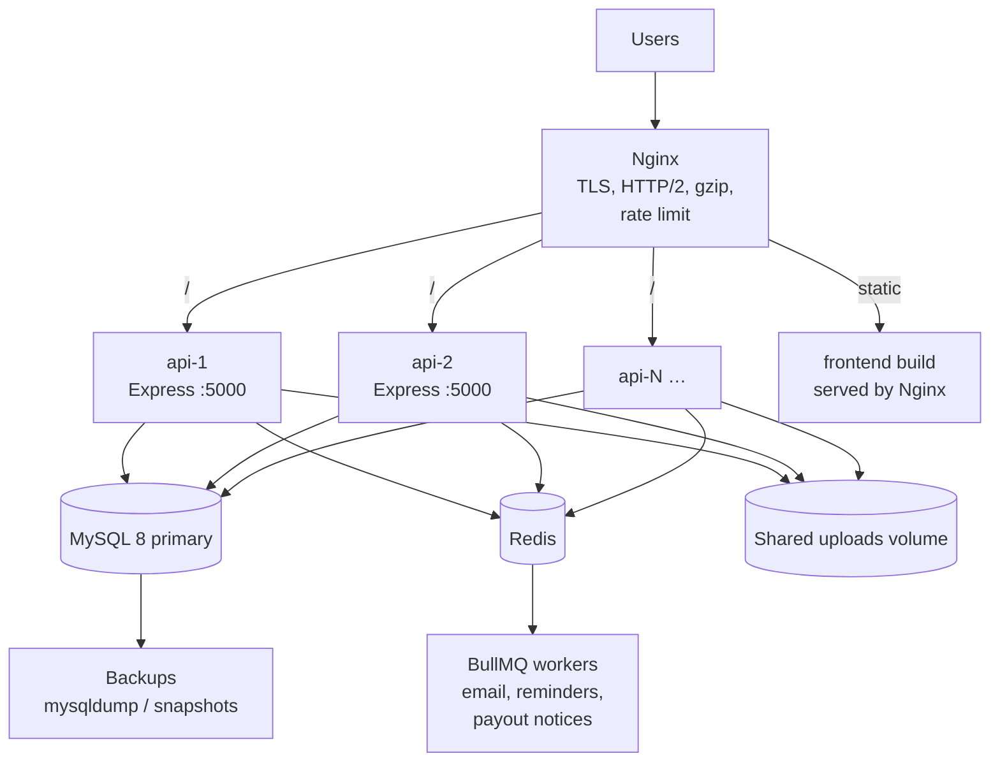

# Load Balancing and Horizontal Scaling

## 1. Why the API scales horizontally

The API is stateless at the request level:

- **No server-side sessions** — access tokens are Bearer JWTs; refresh tokens are rows in MySQL with rotation.
- **One source of truth** — bookings, inventory, payments, balances and audit live in MySQL. Redis only accelerates reads and carries jobs.
- **No sticky routing** — any replica can serve any request. Nginx round-robins.
- **Uploads** — files are written to a shared volume (or object storage) mounted into every replica; only the path is stored in MySQL.

## 2. Deployment topology



Compose ships two API replicas by default (`deployment/docker-compose.yml`); scale with `docker compose up --scale api=4`.

## 3. Redis and BullMQ — graceful degradation

```mermaid
flowchart LR
  S[Service code] --> E[enqueue(job, data)]
  E --> Q{REDIS_URL set<br/>and reachable?}
  Q -->|yes| B[BullMQ queue]
  B --> W[Worker concurrency 5<br/>retries: 3, exponential backoff]
  Q -->|no / init failed| I[Run handler inline]
  I --> R1[notification.email]
  I --> R2[booking.reminder]
  I --> R3[payout.requested]
```

- `QUEUE_ENABLED` plus a valid `REDIS_URL` enables BullMQ. If the connection fails at boot, the process logs and falls back to inline execution instead of crashing.
- Inline execution is synchronous within the request/job that triggered it; failures are logged and never roll back the business transaction that queued them.
- The cache has the same pattern: Redis when configured, an in-process TTL map otherwise. Cache misses and Redis errors fall through to MySQL.
- Business truth never depends on Redis: losing Redis only degrades latency and asynchronous delivery, never booking or money correctness.

A standalone worker entry point exists (`npm run worker` in `backend/`) for deployments that want to keep API and job processes separate:

```
api replicas (HTTP only)  →  Redis queue  →  worker replicas (npm run worker)
```

By default the API process also starts a worker when Redis is configured, which is convenient for small deployments.

## 4. Nginx responsibilities

- Terminate TLS, redirect HTTP → HTTPS.
- Serve the built SPA with history fallback (`try_files $uri /index.html`).
- Proxy `/api/` to the `pothik_api` upstream (`least_conn`), preserving `Host`, `X-Forwarded-*` and `X-Request-Id`.
- Proxy `/uploads/` to the API or serve the shared uploads volume directly.
- Cap client body size above the API upload limit (6 MB+), add gzip/brotli, long-cache hashed assets.
- Optionally add `limit_req` at the edge; the API also enforces its own limits.

See `deployment/nginx/pothik.conf`.

## 5. Scaling rules of thumb

| Component | Scale | Notes |
| --- | --- | --- |
| API | Horizontal, 2+ | Keep `DB_POOL_MAX` × replicas below MySQL `max_connections` |
| MySQL | Vertical first, then read replicas | Bookings and payments are write-heavy and transactional; keep one primary |
| Redis | Single instance is enough initially | Persistence optional; it holds cache and transient jobs |
| Workers | 1–2 | Concurrency 5 per worker; scale with email/payout volume |
| Uploads | Shared volume or object storage | Local disk per container is not acceptable behind a balancer |

## 6. Caveats to respect in production

- **SQLite is development/test only.** Replicas require MySQL; the compose stack uses MySQL 8.
- **Rate limiting is per process** by default (`express-rate-limit` memory store). Behind N replicas the effective limit is N × configured value. Use a Redis store or enforce limits at Nginx if strict global limits are required.
- **In-process cache** diverges across replicas; it is only a performance layer and has short TTLs.
- **Booking expiry** is not yet automated (see [BOOKING_WORKFLOW.md](BOOKING_WORKFLOW.md)); abandoned unpaid bookings hold inventory.
- **Graceful shutdown** — the server closes the HTTP listener and queue connections on `SIGTERM`; in-flight transactions finish. Give the load balancer a drain period longer than the longest request.

## 7. Health checks

| Probe | Path | Use |
| --- | --- | --- |
| Liveness | `/api/v1/health/live` | Restart container if it fails |
| Readiness | `/api/v1/health/ready` | Remove replica from rotation when MySQL is unreachable |
| Full health | `/api/v1/health` | Uptime, environment, database status |

Configure container health checks and Nginx `max_fails`/`fail_timeout` so a failing replica is ejected quickly.
